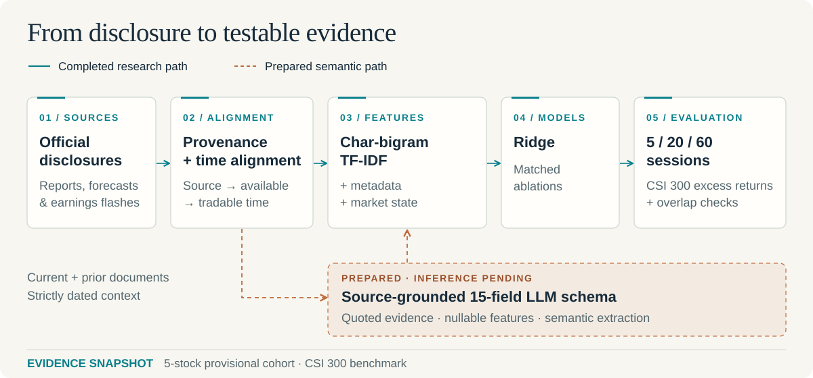
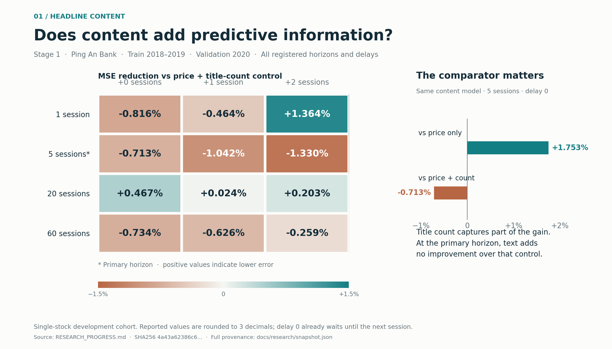
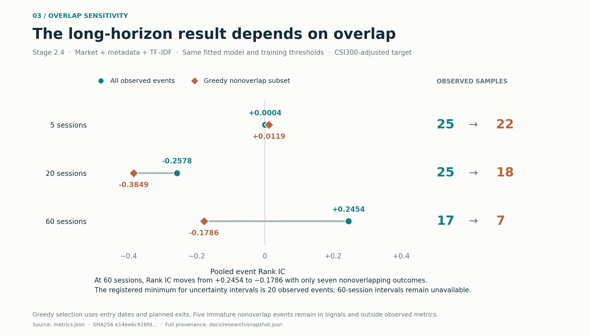
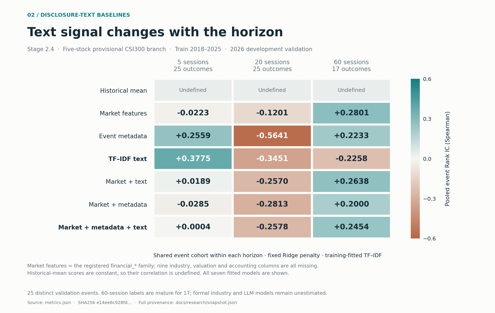

<p align="center">
  
</p>

# A-Share NLP & Event Research

**We built an NLP framework that measures what Chinese financial text adds to return forecasts based on market data.** It combines character-bigram text models, controlled feature comparisons, and returns measured after disclosure.

The research connects three parts of a financial text signal: its content, its arrival time, and the market response that follows. By defining each part explicitly, we can test whether richer language representations improve predictions beyond prices, volume, and document metadata.

## Research contributions

- **Measure the value of text content.** We compare text features with market data and document-count controls on the same observations. This shows how the choice of control changes the apparent contribution of NLP.
- **Define prediction in event time.** We connect disclosure timing to benchmark-adjusted returns over 5, 20, and 60 trading sessions. Each target has an explicit entry price, exit price, and information cutoff.
- **Test how return overlap affects ranking.** We evaluate the same fitted model on all observed events and on a subset with non-overlapping holding periods. This reveals how much the reported association depends on the evaluation sample.

The completed studies cover headline content and official financial disclosures. A prepared semantic extraction interface extends this framework to fundamental news, surprise, and the market's prior price response.

<p align="center">
  <a href="#nlp-and-mathematical-formulation">NLP & mathematics</a> ·
  <a href="#what-the-experiments-show">Experimental findings</a> ·
  <a href="#next-surprise--market-state">Surprise × market state</a> ·
  <a href="#reproduce-the-figures">Reproduce</a>
</p>



## NLP and mathematical formulation

### 1. Represent Chinese text with character bigrams

We encode text as adjacent character pairs. This provides a direct lexical baseline without a word-segmentation dictionary. The vocabulary contains at most 512 bigrams, selected from training documents.

For a bigram with count $c_{dj}>0$ in document group $d$, we apply sublinear term frequency and smoothed inverse document frequency:

```math
u_{dj}=(1+\log c_{dj})\left(1+\log\frac{1+N_{\mathrm{train}}}{1+\mathrm{df}_{j,\mathrm{train}}}\right),
\qquad x_d=\frac{u_d}{\lVert u_d\rVert_2}.
```

Here $N_{\mathrm{train}}$ counts training document groups, and $\mathrm{df}_{j,\mathrm{train}}$ counts those containing bigram $j$. Absent bigrams receive zero weight. An empty group remains a zero vector.

We fit the vocabulary and IDF on training data, then reuse them in validation. This keeps the text representation tied to the information available during training.

### 2. Measure the increment from language

Let $m_e$ describe market conditions, $z_e$ describe the document, and $x_e$ encode its text. We fit registered combinations of these features with the same ridge objective:

```math
(\hat b,\hat\beta)=\underset{b,\beta}{\arg\min}\;
\sum_{e\in\mathcal T}\left(y_{e,H}-b-\phi_e^\top\beta\right)^2
+10\lVert\beta\rVert_2^2.
```

The full model uses $\phi_e=[m_e,z_e,x_e]$. Removing feature groups creates matched comparisons. The fixed penalty keeps the fitting rule constant, and the intercept remains unpenalized.

For a control model $C$, the reduction in validation mean squared error (MSE) measures the gain from adding text:

```math
\Delta_{\mathrm{text}}(H)
=100\left(1-\frac{\mathrm{MSE}_{C+\mathrm{text},H}}
{\mathrm{MSE}_{C,H}}\right).
```

A positive value means that text reduces prediction error. In the headline study, $C$ includes price, volume, title count, and title presence. In the disclosure study, document metadata includes event type, source, document length, and event count.

**Research value:** the comparison measures what text adds after accounting for observable information arrival and market conditions.

### 3. Align the target with the disclosure

For Stage 2.4, we measure returns from the first eligible session open after the assumed disclosure-availability bound plus five minutes. An $H$-session target includes the entry session:

```math
y_{e,H}=
\left(\frac{P^{C}_{s,i+H-1}}{P^{O}_{s,i}}-1\right)
-\left(\frac{P^{C}_{B,i+H-1}}{P^{O}_{B,i}}-1\right),
\qquad H\in\{5,20,60\}.
```

Here $s$ denotes the stock, $B$ denotes CSI 300, and $i$ denotes the entry session. Superscripts $O$ and $C$ denote opening and closing prices. Training excludes targets whose holding periods cross into validation.

This formulation gives the text and return a common timeline. It also fixes the benchmark and holding period before comparing models.

### 4. Evaluate ranking across return windows

We measure ranking quality with Spearman correlation across stock-events that have observed returns:

$$
\mathrm{RankIC}_H=
\mathrm{Corr}_{e\in\mathcal V_H}
\left(\mathrm{rank}(\hat y_{e,H}),
\mathrm{rank}(y_{e,H})\right).
$$

The comparison keeps the fitted model fixed and removes overlapping holding windows within each stock. We report both estimates with their sample counts. This makes the sensitivity to event overlap visible at each horizon.

## What the experiments show

### Headline content: the control changes the interpretation

The headline study uses **Ping An Bank**, with training in **2018–2019** and validation in **2020**. It covers four horizons and three additional processing delays. The 2021 reserve remains untouched.

At the primary five-session horizon, the content model reduces MSE by **1.753%** relative to price and volume alone. Relative to a control that also includes title count and presence, MSE **increases by 0.713%**. Both comparisons use zero additional delay.

This result establishes the role of the count control in this experiment. A comparison against market data alone would overstate the incremental value of headline content.



*The primary comparison uses 461 training observations and 238 validation observations. Zero additional delay already waits until the next session after the source date.*

### Disclosure events: overlap changes the long-horizon ranking

The disclosure study uses **306 unique events across five stocks**. Training covers **2018–2025**, followed by **2026 development validation**. The October 4 snapshot includes market data through September 30, 2026.

We compare seven baselines across three horizons. The model below combines market features, event metadata, and TF-IDF text.



| Horizon | Training events | Observed validation outcomes | Pooled Rank IC | Non-overlap outcomes | Non-overlap Rank IC |
| ---: | ---: | ---: | ---: | ---: | ---: |
| 5 sessions | 276 | 25 | +0.0004 | 22 | +0.0119 |
| 20 sessions | 276 | 25 | −0.2578 | 18 | −0.3849 |
| 60 sessions | 271 | 17 | +0.2454 | 7 | −0.1786 |

At 60 sessions, Rank IC changes from **+0.2454 to −0.1786** after overlap removal. The remaining sample contains seven outcomes. This demonstrates why event overlap belongs in the evaluation of long-horizon text signals.

<details>
<summary><strong>All seven baselines and three horizons</strong></summary>



The market feature family corresponds to `financial_only` in the code. Its available inputs chiefly describe prices, volume, and market conditions. Nine industry, valuation, and historical accounting columns are missing in this run. The constant historical-mean model has undefined Rank IC.

The 525 model predictions represent **25 distinct validation events**. Adding TF-IDF to market features and metadata changes the ranking metrics but produces the same trades under the fixed entry rule.

[View the complete numerical results.](docs/research/snapshot.json)

</details>

**Study scope.** These estimates describe predictive associations in the development samples above. The disclosure study uses CSI 300 as its benchmark. Historical industry coverage and document dates and versions need further verification. The 60-session sample falls below the 20-outcome minimum for confidence intervals. See the [methods note](docs/research/README.md) for details.

## Next: surprise × market state

We implemented a 15-field semantic extraction interface for fundamental direction, earnings quality, surprise, demand, margins, persistence, novelty, and risk. Each supported field links to a source quotation. The input combines the current disclosure with up to three strictly earlier documents.

The next experiment tests whether information has greater predictive value when it changes expectations and follows a smaller prior price response. One registered interaction combines surprise $S_e$, persistence $\Pi_e$, and a measure of that response:

```math
g_e=S_e\,\Pi_e\left[1-\widehat F_{\mathrm{train}}\!\left(r_e^{\mathrm{prior}}\right)\right].
```

The empirical CDF expresses prior relative return as a percentile of training observations. Its complement assigns higher weight to smaller prior returns. The default design uses the pre-event 20-session industry-relative return.

The planned **Surprise × Priced-in** grid will compare event counts and subsequent returns across its four cells. This extension is prepared for inference. Completing historical industry data and audited guidance-to-actual comparisons precedes the first LLM experiment. Unsupported surprise values remain `null`.

The 2026 development window also motivates a question about quantitative crowding and event responses. Testing that mechanism will require a separate crowding measure. Later observations will support prospective validation under a newly frozen protocol.

## Reproduce the figures

The script reads the published result tables and generates all three experimental figures:

```bash
git clone https://github.com/TanhJK728/A-Share-LLM-Trading-Research.git
cd A-Share-LLM-Trading-Research
python -m venv .venv
source .venv/bin/activate
python -m pip install -r docs/research/requirements.txt
python scripts/render_research_figures.py
```

[Result tables](docs/research/snapshot.json) · [Plotting code](scripts/render_research_figures.py) · [Methods](docs/research/README.md)

## Repository context

The original system supplies market-data collection, Qlib feature export, LightGBM modeling, and experimental sentiment and trading modules.

| Code | Role |
| :--- | :--- |
| [`data_ingestion/`](data_ingestion/) | Collect market, benchmark, concept, and news data |
| [`data_processing/`](data_processing/) | Export data for Qlib |
| [`research/`](research/) | Original factor, sector, and sentiment experiments |
| [`backtest/`](backtest/) · [`trade/`](trade/) | Original simulation and execution prototypes |

The research framework connects financial language to explicit prediction targets and controlled empirical tests. It provides a common basis for comparing lexical models, structured financial semantics, and future language-model representations.
